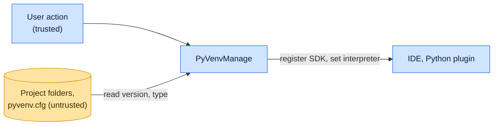

# Threat model

This model says what PyVenvManage trusts, where untrusted input enters, and which guarantees hold at each boundary, so a
report can be classified as a vulnerability or a bug. [SECURITY.md](SECURITY.md) covers reporting; if the two disagree,
SECURITY.md wins and we fix this file.

## How PyVenvManage works

PyVenvManage scans the project view for folders that hold a `pyvenv.cfg` and a Python executable, and decorates them
with the environment type and the Python version read from `pyvenv.cfg`. When the user right-clicks such a folder and
chooses an action, it registers that interpreter as an SDK and sets it for the project or module. It starts no process
and opens no network connection of its own.

## Compared with similar tools

We drew the boundary where comparable projects in other ecosystems draw theirs. The shared rule, stated by the
[Node.js threat model](https://github.com/nodejs/node/blob/main/SECURITY.md#the-nodejs-threat-model), is that a report
which first needs a trusted element compromised is out of scope; the first triage question, as
[DOMPurify](https://github.com/cure53/DOMPurify/blob/main/SECURITY.md#what-we-consider-a-vulnerability) puts it, is what
the attacker controls.

| Project                                                                                          | Language        | Where it draws the line                                                                             |
| ------------------------------------------------------------------------------------------------ | --------------- | --------------------------------------------------------------------------------------------------- |
| [JetBrains project trust](https://www.jetbrains.com/help/idea/project-security.html)             | Kotlin and Java | A project opened in safe mode runs no build scripts or run configurations until the user trusts it. |
| [VS Code Workspace Trust](https://code.visualstudio.com/docs/editing/workspaces/workspace-trust) | TypeScript      | Extensions disable features that run workspace code until the user trusts the folder.               |
| [IntelliJ Platform](https://github.com/JetBrains/intellij-community/security/policy)             | Kotlin and Java | Vulnerabilities in the IDE platform itself go to JetBrains, not to plugin authors.                  |

## Trusted

An attacker who controls any of these already has what PyVenvManage could give them:

- The user and the actions they choose.
- The IDE, the Python plugin and the SDK table.

## Untrusted inputs

| Input                          | Comes from       | What PyVenvManage guarantees                      |
| ------------------------------ | ---------------- | ------------------------------------------------- |
| `pyvenv.cfg` and folder layout | A cloned project | Read as text to label the folder; never executed. |

## Threats and controls

| STRIDE                 | Threat                                                          | Control                                                                             |
| ---------------------- | --------------------------------------------------------------- | ----------------------------------------------------------------------------------- |
| Tampering              | A crafted `pyvenv.cfg` points the plugin outside the project.   | The interpreter path comes from the folder the user clicked, not from `pyvenv.cfg`. |
| Elevation of privilege | Opening a project silently switches to a malicious interpreter. | Interpreters change only on an explicit action.                                     |

## Release chain

Releases run on the shared [tox-dev/github-workflows](https://github.com/tox-dev/github-workflows) pipeline. A release
App pushes the release commit and tag, the plugin ZIP is signed before it reaches the
[JetBrains Marketplace](https://plugins.jetbrains.com/docs/marketplace/plugin-signing.html), and the immutable GitHub
Release carries the same ZIP with GitHub's release attestation. Every workflow pins third-party actions to a commit SHA.

## Vulnerability or bug

| Report                                                            | Verdict             | Why                                     |
| ----------------------------------------------------------------- | ------------------- | --------------------------------------- |
| Opening a project sets its `.venv` as interpreter without a click | Vulnerability       | Interpreter changes need a user action. |
| The user picks a malicious `.venv` and the IDE runs it            | Not a vulnerability | The user chose it.                      |
| A folder shows the wrong Python version                           | Bug                 | Label only.                             |

## Accepted risks

- The plugin does not consult the IDE's trusted-project state; it reads `pyvenv.cfg` in untrusted projects too.

## Keeping this current

Revisit this model when PyVenvManage gains a new input source, network access, a new way to run code, or a new place it
writes to, and whenever an advisory is published.
